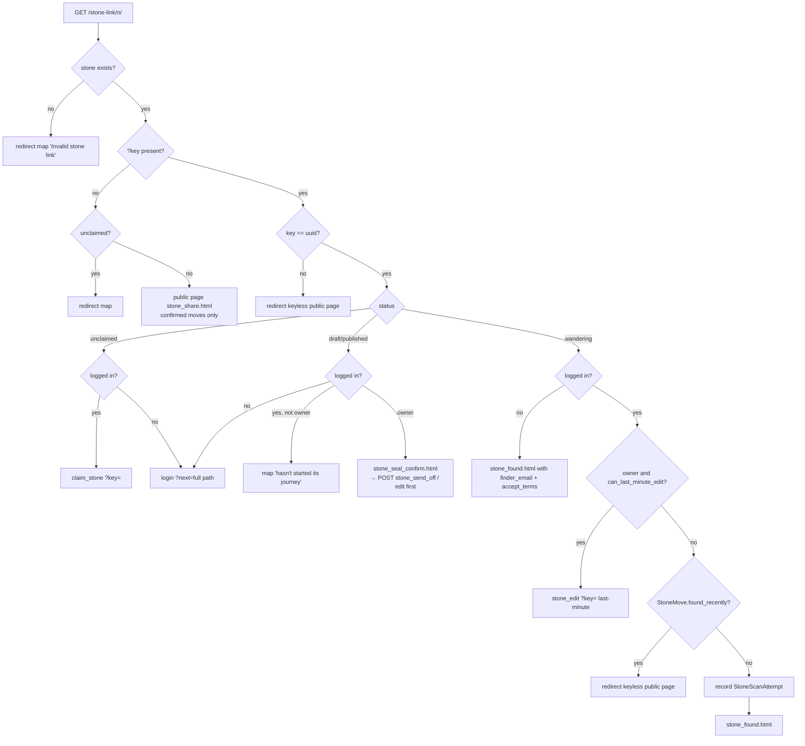
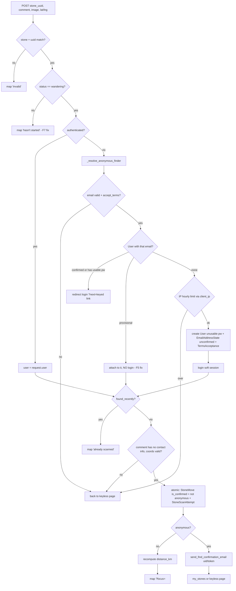
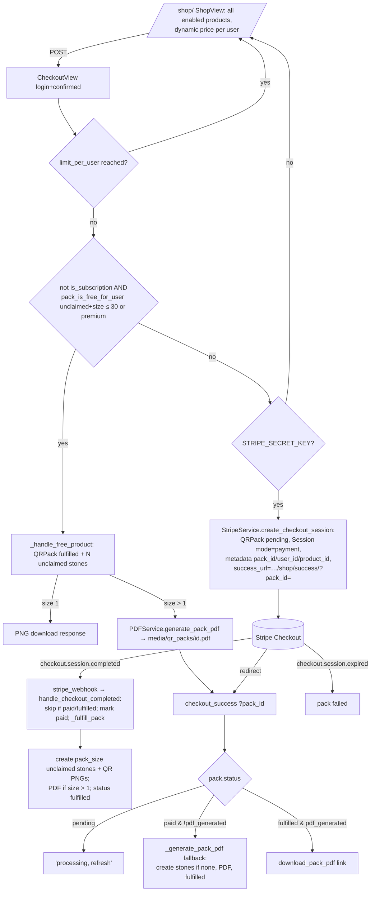
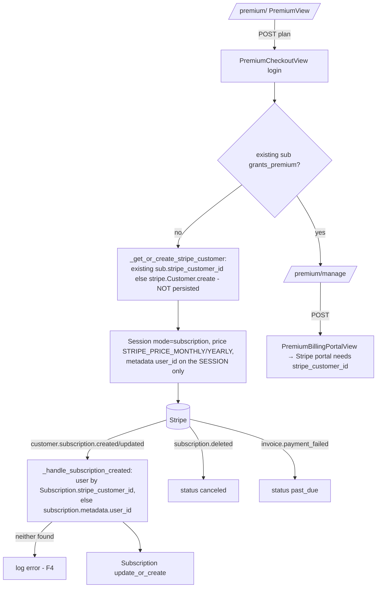

# Process flows (derived from code)

Snapshot: the working tree on 2026-09-26, with fixes from other agents half-applied (F1, F2, F6, F7, F13, F14 and A2 to A4 are already visible in the code). `⚠` marks a place where I suspect a bug. Suspicions the team already tracks point to their task ID; new ones are collected at the end. Paths are relative to `source/`.

---

## (a) Stone lifecycle

```mermaid
stateDiagram-v2
    [*] --> unclaimed: CreateNewStoneView GET / FreeQRView GET /\nCheckoutView._handle_free_product /\nStripeService._fulfill_pack (webhook) /\nCheckoutSuccessView._generate_pack_pdf (fallback)
    unclaimed --> draft: ClaimStoneView.post\n(key + login + confirmed email; PK renamed via delete+create in atomic block)
    draft --> published: StoneEditView.post action=publish (owner)
    draft --> wandering: StoneSendOffView.post (owner, from stone_seal_confirm.html;\nconfirm_no_image required if no picture)
    published --> wandering: StoneSendOffView.post
    wandering --> wandering: StoneLinkView.post (finds → StoneMove)
```



- **unclaimed**: `FK_user=None`, `PK_stone='UNCLAIMED-XXXXXXXX'`. The owner is the pack owner (`FK_pack.FK_user`). A `stone_number` is assigned in `Stone.save()` as `Max+1` (race condition, F8).
- **Claim** (`shop_views.py:135-285`): name ≤10 characters, no whitespace, unique (F10: no charset check). Because the PK changes, the row is deleted and re-created with the same `uuid` and `stone_number`, so the printed QR keeps working. If someone else claims a code from your pack, you get a `send_code_claimed_email`.
- **draft**: fully editable in `StoneEditView`. `can_download_qr` is true for unclaimed, draft and published.
- **published**: an optional middle state. The regular edit page is read-only. ⚠ The message says "It's now visible on the map", but the map only lists stones that have at least one confirmed `StoneMove` (`views.py:143`), and `publish()` creates no move. So published **and freshly sealed stones are invisible on the map until their first find** (NEW-7).
- **wandering**: `wandering_at` is set and the certificate becomes available. QR download is closed.
- **Last-minute edit**: `Stone.can_last_minute_edit()` is true for published or wandering stones when no non-owner has a move **or a scan attempt**. It only unlocks through the QR key (`StoneEditView._last_minute_unlocked`). A logged-in non-owner who merely *opens* the key link records an attempt and closes the window. An anonymous visitor who opens the link does not; their find POST does.
- **Where old docs disagree with the code**:
  - `wiki/features/stone-management.md` says sealing happens on the QR scan (GET), shows `stone_sealed.html`, and calls `StoneSendOffView` deprecated. In the code, the GET shows a confirm page, the seal is a POST to `stone_send_off`, and `stone_sealed.html` is an orphan.
  - The same page claims a limit of "one draft stone per non-premium user". `user_can_create_stone` is never called.
  - It also says hunted stones get an initial `StoneMove` at creation. The claim flow creates none.
  - `CLAUDE.md` says "1 unclaimed at a time". The code allows `FREE_UNCLAIMED_CAP = 30` free codes, then 50¢ per code.

---

## (b) QR scan flow: `StoneLinkView` (`/stone-link/<n>/?key=<uuid>`)



**POST** (`views.py:626-735`):



- **Blackout**: one week per (stone, finder). It is now based on `StoneMove.found_recently`, so held finds count too (F1 fixed). `StoneScanAttempt` is still written on GET and POST and is used for the last-minute window and the IP limit. It has `unique_together(stone, user)` and is updated in place.
- **Held finds**: `is_confirmed=False`. They are hidden from the map, the share page and the distance. They are released by `confirm_pending_finds(user)`, which is called from:
  - `ConfirmAccountView.form_valid`: the link in the find-confirmation email, where the finder sets a password.
  - `ChangeEmailActivateView`: new with the A4 fix.
- ⚠ **NEW-2**: `is_confirmed = not anonymous`. A brand-new provisional finder is **logged in** (soft session) after their first find, so their *next* find on any stone takes the authenticated branch and is stored **confirmed**. It goes straight onto the map and into the distance without the email ever being confirmed. The check should be `is_email_confirmed(user)`.
- ⚠ **NEW-3**: `_resolve_anonymous_finder` checks only `User.email`. If the email is pending in *another* account's `EmailAddressState.email` (which is unique), then `User.objects.create` succeeds and `EmailAddressState.get_or_create` raises `IntegrityError`. The result is a 500 plus an orphan User with no state row, and `is_email_confirmed()` treats such a user as a **confirmed legacy account**.
- ⚠ The owner is emailed about held finds (F15). The `post_save` signal fires on create. `confirm_pending_finds` uses `.update()`, so after the F15 fix the owner will get **no** email when a held find is confirmed (NEW-16).
- ⚠ Hunted stones: `new_latitude`/`new_longitude` go only into the finder's session (F18, parked).
- Cookie `stone_scan_<uuid>` (7 days) is set on the found page and read by nothing.

---

## (c) Shop purchase



- `CreateNewStoneView` (the "Create stone" button) and `FreeQRView` mint a free single code **on GET** when it fits the allowance, otherwise they redirect to the shop (⚠ NEW-10, CSRF-able).
- `QRPack.language` exists but nothing sets or reads it, so pack PDFs are always English.
- ⚠ **NEW-1 (money)**: `shop.html` loops over *all* enabled products, including `premium_monthly` and `premium_yearly`, which are in `shop_config.json` with `pack_size: 0`, and renders a "Buy Now" form that POSTs to `/shop/checkout/premium_monthly/`. `CheckoutView` does not reject `is_subscription`, so it creates a **one-time** $3.99 / $29.99 payment session with `QRPack(pack_type='premium_monthly')`. The webhook's `_fulfill_pack` then reads `pack_size = 0`, creates zero stones and marks the pack fulfilled. No `Subscription` is ever created. **The user pays and gets nothing.** The real subscription path is `/premium/checkout/`.
- ⚠ **NEW-11**: the success page's "fallback" only runs when `status == 'paid'`, and only the webhook sets `paid`, immediately before fulfilling. If the webhook never arrives, the pack stays `pending` forever, because the success page never asks Stripe about the session. The fallback only fires when the webhook crashed mid-fulfilment, and then it "fulfils" with the partial stone set (F8/F9).
- ⚠ **NEW-11b**: a paid **single** code (`free_single` beyond the allowance, 50¢) is fulfilled without a PDF, so `pdf_generated=False` and status is fulfilled. `checkout_success.html` shows neither a download nor "processing". The only way to get the code is My Stones.
- `DownloadPackPDFView` regenerates the PDF on every download, with labels for **all** of the pack's stones, including ones already claimed by other users (a teacher gets their students' keys; low risk).
- Double fulfilment between the webhook and the fallback is F9; the stone-number race is F8; an empty webhook secret is F11 (the payments agent owns these).

---

## (d) Premium subscription



- **Early users**: `grant_early_premium` gives a `lifetime` / `active` Subscription to users numbered ≤ `SHOP_VISIBLE_USER_THRESHOLD` (1000 on prod, 100 on dev). It runs on activation (`ActivateView`) and on email-first confirmation (`ConfirmAccountView`).
- `Profile.is_premium` is `subscription.grants_premium`, meaning active, trialing, or canceled with the period not yet ended. Premium lifts the 30-code cap and makes all packs free.
- F4 (the payments agent is on it): a new user has no Customer ID stored and no `subscription_data.metadata`, so the webhook can't find them. Each checkout also creates a fresh Stripe Customer.
- `premium_manage` is the success URL; the `?subscription=1` it receives is ignored.

---

## (e) Signup, activation, password reset, email-first, Discourse SSO

```mermaid
flowchart TD
    SU[sign-up POST SignUpForm] --> U[User is_active=False + EmailAddressState unconfirmed + TermsAcceptance\nsession post_activation_redirect=next]
    U --> AM{send_activation_email ok?}
    AM -- no --> DEL[delete user - 'failed to send']
    AM -- yes --> ACT[/accounts/activate/code/ ActivateView:\nis_active, state confirmed, grant_early_premium]
    ACT --> LI[log-in ?next=post_activation_redirect]
    RP[restore/password] --> RPE[email uid/token] --> RPC[RestorePasswordConfirmView sets pw → log-in]
    AF[anonymous find, see b] --> CF[confirm/uid/token ConfirmAccountView:\nset pw + login, state confirmed, is_active,\nconfirm_pending_finds, grant_early_premium]
    CH[change/profile new email] --> CA[Activation email=new, state email=new unconfirmed old_email=user.email] --> CE[change/email/code → user.email=new, confirm, release finds]
    CH --> CX[cancel-email-change → state email=old_email, is_confirmed=True]
    DS[Discourse → discourse-sso?sso&sig] --> HV{HMAC ok?}
    HV -- no --> 400
    HV -- yes --> LG{logged in?}
    LG -- no --> SESS[store sso/sig in session → log-in ?next=discourse-sso]
    LG -- yes --> RET[signed payload external_id,email,username,avatar\n+require_activation if unverified - A3 fix] --> DC[(forum/session/sso_login)]
```

- The login forms reject `is_active=False`. Email-first accounts are `is_active=True` with an unusable password, so they can't log in with a password. Their only session is the soft login made at find time.
- ⚠ **NEW-4**:
  - A provisional user holding that soft session can open Edit Profile and set `password1` **without a current password** (`CombinedProfileForm` needs none), and without confirming the email.
  - `RestorePasswordView` also works for provisional users, since `is_active=True`. Neither path confirms the email or releases held finds, and there is **no "resend find confirmation" route**.
  - `cleanup_unconfirmed` skips any account with a usable password.
  - Result: held finds stay in limbo forever. Whoever types an address first squats it: the real owner can't sign up (`SignUpForm` rejects the address) and has to use password reset, which still leaves the account unconfirmed.
- ⚠ **NEW-5**: `ChangeProfileView` always stores `old_email=user.email`, even when that address was never confirmed. `CancelEmailChangeView` then sets `is_confirmed=True` for it (`accounts/views.py` around line 640). So a provisional (or never-activated) account can **confirm an address it never verified**: start a change, then cancel. That bypasses `_require_confirmed_email` (minting QR codes) and the A3 `_email_verified` check for Discourse.
- ⚠ **NEW-14**: `send_mail()` returns False on failure. `_send_find_confirmation` ignores the result, so the finder is told "check your email" even when nothing was sent.
- ⚠ The token is `default_token_generator`, whose hash includes `last_login`. Any later login of the provisional user, such as a second soft login from another device, invalidates the confirmation link that was already emailed.
- Discourse: the session keeps `sso`/`sig` indefinitely. The nonce's freshness is only checked on the Discourse side.
- `accounts/templates/accounts/resend_activation_code.html` is unreachable from the UI (see the sitemap).

---

## New suspicions

Things I found that are not already on the task board. Numbered NEW-n; file:line refers to the current working tree.

1. **Premium products are sold as one-time "packs" in the shop, and the buyer gets nothing.** `content/templates/main/shop.html:79-145` (unfiltered product loop), `main/shop_views.py:404-432` (`CheckoutView` never rejects `is_subscription`), `main/stripe_service.py:143` (`pack_size` 0 → 0 stones). P1 money.
2. **A provisional finder's 2nd+ find skips the hold.** `main/views.py:~699`: `is_confirmed=not anonymous`, and the soft session makes later POSTs authenticated. Use `is_email_confirmed(user)`. The same applies to the distance recompute and the owner notification.
3. **Anonymous find with an email pending on another account → IntegrityError 500, plus an orphan User that counts as "confirmed legacy".** `main/views.py:~596-611` (only `User.email` is checked; `SignUpForm` got the `EmailAddressState` guard, this path didn't).
4. **Provisional accounts can get a password without confirming, and held finds get stuck.** Profile password change needs no current password (`accounts/views.py:~558`, `accounts/forms.py:330`). Password reset works for provisional users but doesn't release finds. There is no resend-confirmation route. `main/management/commands/cleanup_unconfirmed.py:36` skips users with a usable password. Also email squatting.
5. **Cancelling an email change confirms an address that was never verified.** `accounts/views.py:636-650` (`CancelEmailChangeView` sets `is_confirmed=True`) together with `ChangeProfileView` storing `old_email=user.email` unconditionally (`accounts/views.py:480`). Bypasses the email gate and the Discourse `_email_verified` check.
6. **`cleanup_unconfirmed --dry-run` deletes held-find images.** `main/management/commands/cleanup_unconfirmed.py:43-48`: the `move.image.delete()` loop runs before the dry-run check. The command is also not scheduled anywhere (no cron in the deploy docs).
7. **Published and newly sealed stones never appear on the map**, even though the message says "now visible on the map". `main/views.py:143` (`if moves:`) and `main/views.py:312`.
8. **The certificate PDF prints the keyed QR URL** (the QR key is the only secret for recording finds, and certificates get shared). `main/certificate_service.py:206,236`.
9. **Debug pages are routed in production**: `/debug/modals/`, `/qr-test/` at `app/urls.py:86-87`.
10. **State-changing GETs**: `/create-stone/` (`main/shop_views.py:49`) and `/shop/free-qr/` (`main/shop_views.py:482`) mint packs and stones, and `/shop/success/` can fulfil. A cross-site `` can burn a logged-in user's free allowance.
11. **Success page**: (a) it never fulfils when the webhook is missing, since `status=='paid'` is set only by the webhook (`main/shop_views.py:614`); (b) a paid single-code pack shows no download or status block (`content/templates/main/checkout_success.html:42-59`).
12. **Unauthenticated PIL QR generation with no rate limit**: `/api/generate-qr/`, `/api/download-enhanced-qr/` (`main/views.py` `generate_qr_code_api`, `download_enhanced_qr_code`). Low.
13. **The Maileroo backend has no timeout** (`app/backends.py:106`, `urlopen` without `timeout`), and every email is sent synchronously inside the request, so a hung API holds a gunicorn worker for up to 120 s. If `MAILEROO_API_KEY` is unset, the backend raises, `send_mail` returns False, and `SignUpView` deletes the new user. Nobody can sign up, which contradicts the deployment doc's "leave blank to disable email".
14. **A failed find-confirmation email is silently ignored** (`main/views.py` `_send_find_confirmation`).
15. **QR PNGs are written to `media/qr_codes/{PK}_{uuid}.png`** on every generation, then left orphaned when a stone is renamed on claim. Downloads never use them, yet nginx serves them publicly under `/media/` with the key in the filename. `main/qr_service.py:53-57`.
16. **Once F15 is fixed, owners get no notification when a held find is confirmed**: `main/models.py` `confirm_pending_finds` uses `.update()`, so no `post_save` fires.
17. **Keyless `/stone-link/<n>/` and `/stone/<pk>/share/` render draft and published stones publicly.** Numbers are sequential, so unreleased stones can be enumerated. `main/views.py` `StoneLinkView.get` (only unclaimed is hidden) and `StoneShareView`. Low.
18. **`my_stones.html:216,234` still hardcodes unprefixed `/stone/${pk}/edit/` and `/qr/`** (JS side of F13).
19. **`resend_activation_code` has no link anywhere in the UI** (orphan).
